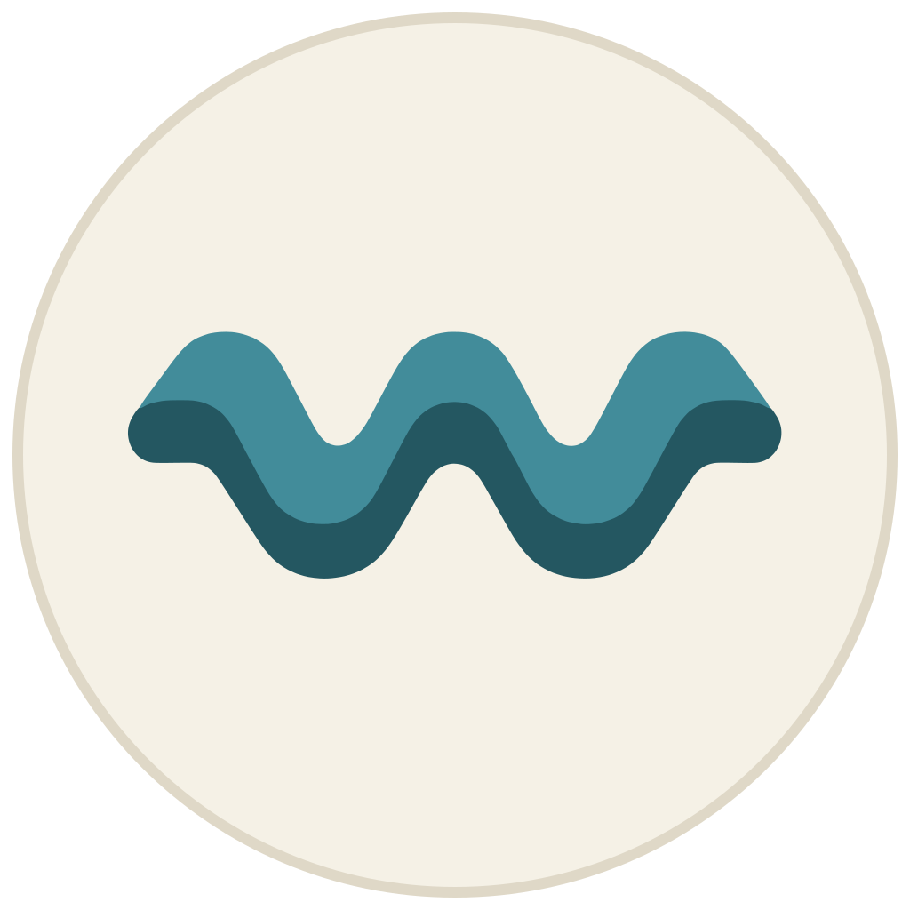
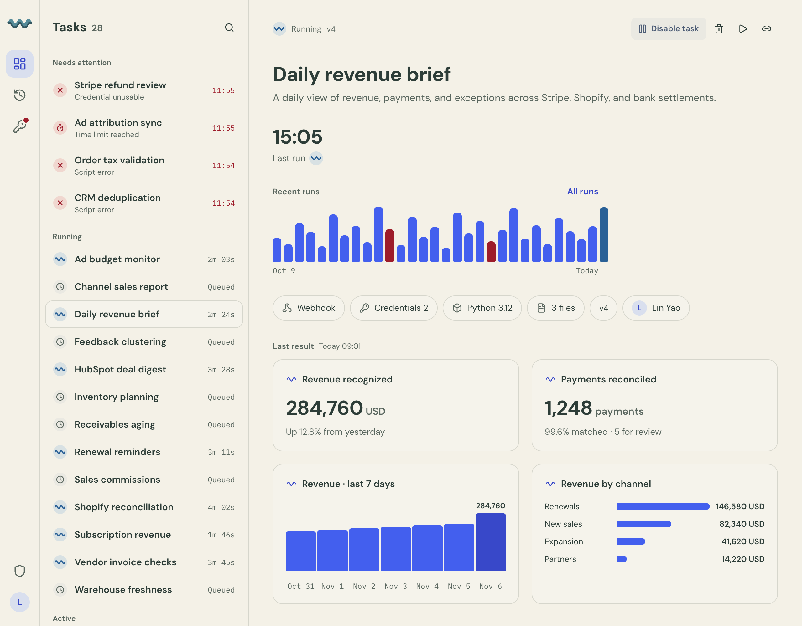
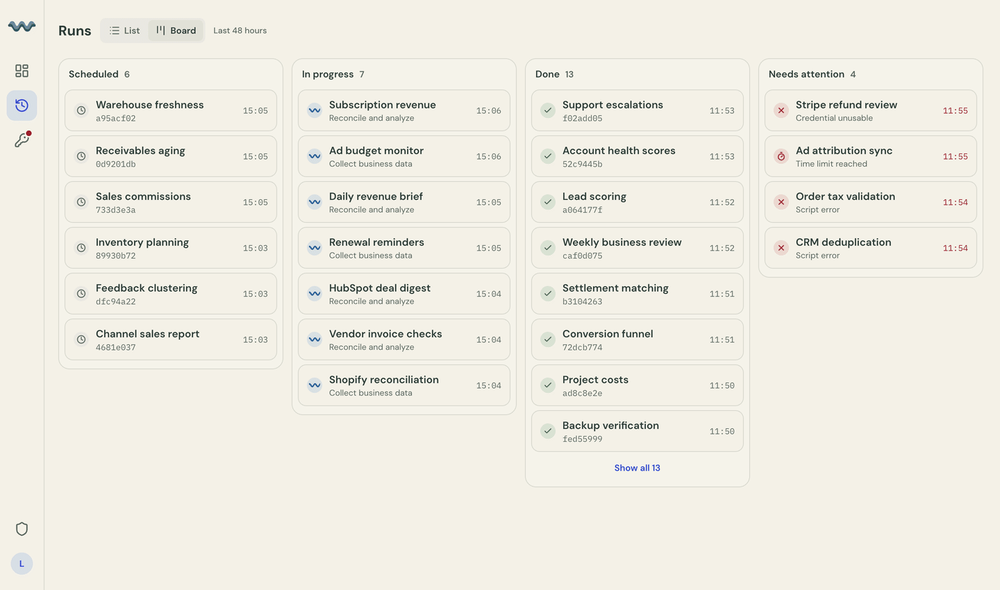
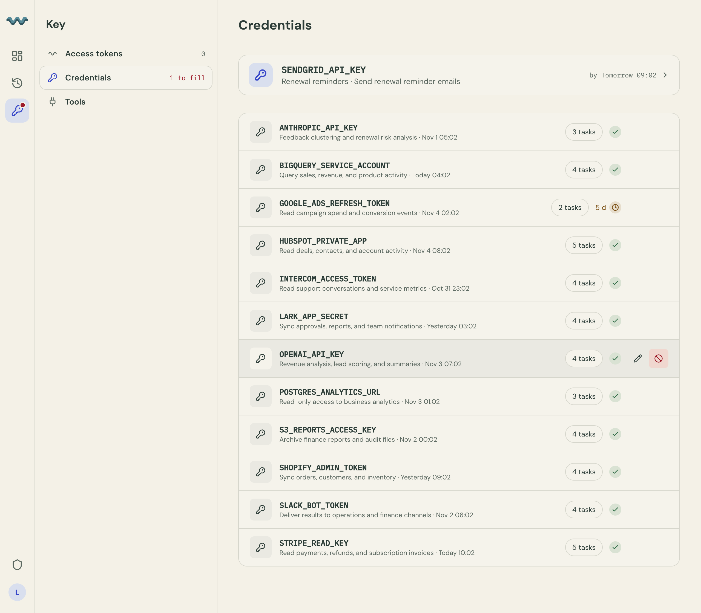

# Lerryn

Run recurring tasks on your own machines through your AI agent. Lerryn schedules Python, Node, and Shell tasks and keeps each run's results, files, and logs together.

[Website](https://lerryn.niltavi.com/) · [Getting started](docs/en/getting-started.md) · [简体中文](docs/zh-CN/README.md)

---

 

<picture>
  <source media="(prefers-reduced-motion: reduce)" srcset="docs/assets/screenshots/runs-board-en.png" />
  
</picture>

 

<a href="docs/en/for-agents.md">For Agents</a>
<a href="https://niltavi.com/">
<picture>
  <source media="(prefers-color-scheme: dark)" srcset="docs/assets/niltavi-logo-dark.svg" />
  
</picture>
</a>

